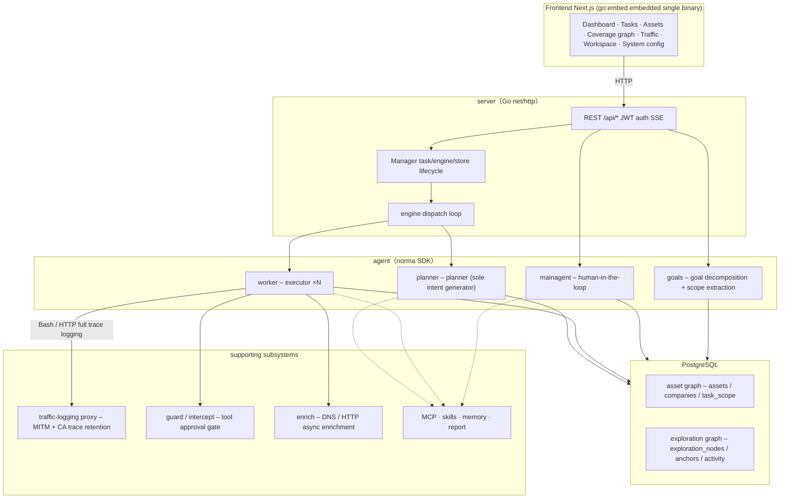
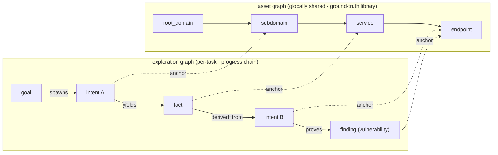
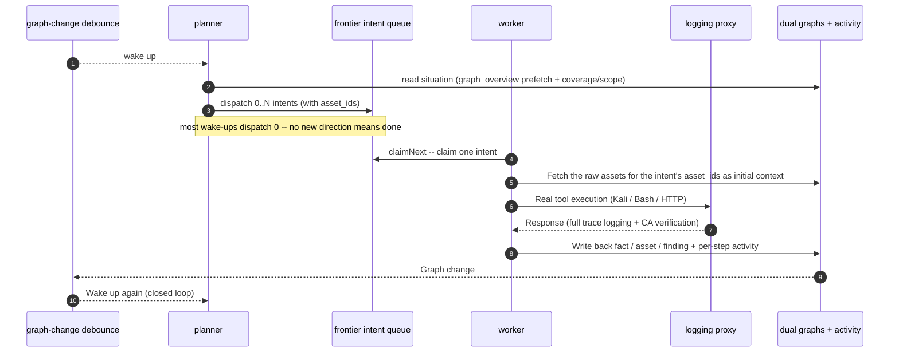
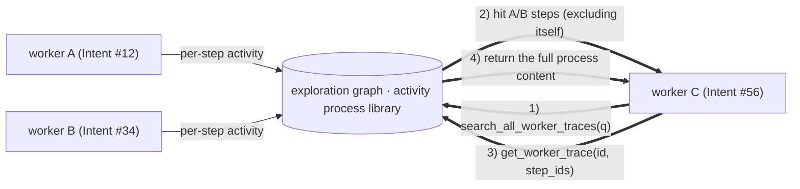
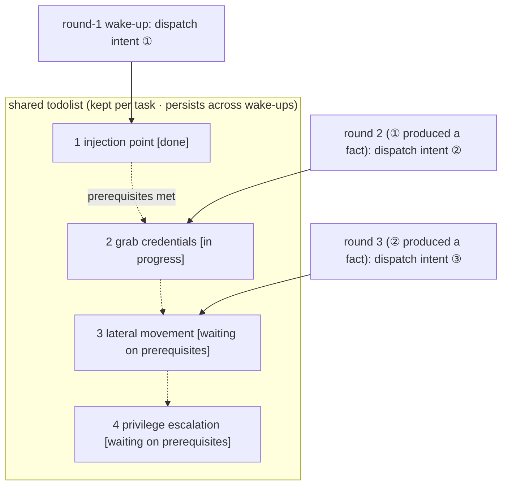

<div align="center">

# ARTEX

AI autonomous penetration testing system (Go backend + Next.js frontend)


🌐 **Live Demo**: [https://artex-demo.vercel.app/](https://artex-demo.vercel.app/)

📦 **This repo is a pure-source backup of the final ARTEX version; Docker deployment sources are expired, just have AI build it locally**

</div>

---

## Screenshot Preview

> See the [live Demo](https://artex-demo.vercel.app/) for the full interaction.

| dashboard (overview / Token usage / Activity feed) | task list |
| :---: | :---: |
|  |  |

| Tasks · execution trace (session / tool call) | exploration chain |
| :---: | :---: |
|  |  |

| Findings | Asset |
| :---: | :---: |
|  |  |

| asset coverage map (force-directed layout · tested highlighted · node collapse/expand) |
| :---: |
|  |

| traffic recording | human-in-the-loop chat |
| :---: | :---: |
|  |  |

| Agent manage | LLM config |
| :---: | :---: |
|  |  |

| intercepted approval | backend logs |
| :---: | :---: |
|  |  |


---

## Approval Record Details

Global "Approval Records", in-task "Intercept Approvals", and approval cards in chat all support expanding to view details. The display structure references
[AegisHook's approval detail component](https://github.com/RuoJi6/AegisHook/blob/main/web/src/components/CallDetail.vue), reusing ARTEX's components and theme:


## Asset Sync (ScopeSentry)

Supports syncing asset data directly from [ScopeSentry](https://github.com/Autumn-27/ScopeSentry), eliminating duplicate collection:

- On the "**Asset Sync**" page, fill in ScopeSentry's address and API Key to connect the data source;
- Select targets and asset types (domains / subdomains / IPs / ports / sites / endpoints...) to sync by **project** or **task**;
- Import with one click and merge by company asset scope, entering ARTEX's asset graph directly for agent exploration.

---

## Installation

> Requires **PostgreSQL** database; exploration requires **LLM** configuration (`ANTHROPIC_API_KEY` or `OPENAI_API_KEY`, can also be configured in the UI).

### Option 1: One-Click Install Script (Recommended)

```bash
git clone https://github.com/Autumn-27/ARTEX.git
cd ARTEX
./install.sh
```

The script will: detect / auto-install Docker -> let you choose **① All Docker** or **② Run Locally**:

- **① All Docker**: enter a Postgres password (press Enter for a random one) -> auto-write `.env` -> `docker compose up -d`.
- **② Run Locally**: choose a database (connect an existing one / start one with Docker) -> generate `config.json` -> compile embedded single binary with `go` -> start.

After installation, open **http://localhost:8787** (first visit `/setup` to set the admin password).

### Option 2: Docker Compose (Manual)

```bash
git clone https://github.com/Autumn-27/ARTEX.git
cd ARTEX
cp .env.example .env          # Fill in POSTGRES_PASSWORD, optional ANTHROPIC_API_KEY
docker compose up -d          # Pull autumn27/artex image + postgres
# → http://localhost:8787
```

The image already includes common tools (ripgrep/curl/vim/npm/nmap...); `./skills` and `./data` persist via bind mounts.

Remote MCP can select `http` (Streamable HTTP) or `sse` (legacy SSE) in system settings.
Legacy SSE services typically use `GET /sse` to establish the event stream, then receive JSON-RPC requests via the service-returned
`/message?sessionId=...`; when configuring, fill the URL as `/sse`, and set request headers per
Fill in `Authorization=Bearer <token>`.

### Option 3: Download Prebuilt Binary (Releases)

Go to [Releases](https://github.com/Autumn-27/ARTEX/releases) to download the zip for your platform; after extracting you get `artex` + `start.sh` (`start.bat` on Windows) + `skills/` + `config.example.json`:

```bash
cp config.example.json config.json   # Fill in the database connection
./start.sh                           # → http://localhost:8787
```

> Start with `start.sh` / `start.bat` instead of running `./artex` directly. It is a supervisor script: after the program exits it decides whether to restart it based on the exit code, and **the one-click update on the page relies on it to complete the swap**. If you run `./artex` directly, it will not be relaunched after an update.
> To keep it running in the background: `nohup ./start.sh >artex.log 2>&1 &`.

### Option 4: Build Single Binary From Source

```bash
# 1) Static Frontend Export
cd web && npm ci && npm run build:static && cd ..
# 2) Copy Into Embedded Directory
cp -r web/out server/webui/dist
# 3) Build (Frontend Embedded Only With -tags embedui)
CGO_ENABLED=0 go build -tags embedui -o artex ./cmd/artex
./start.sh
```

### Option 5: Build Cross-Platform Release Archives

`build.sh` first builds and embeds the frontend, then strips debug info with the Go linker, and compresses the release files into zips. In Release mode it generates zip packages for Linux amd64/arm64, macOS amd64/arm64, and Windows amd64 by default:

```bash
./build.sh --release
# Output: dist/artex-0.3.3-*.zip
```

UPX self-extracting binaries may be incompatible with some Linux kernels, virtualization environments, or security policies, so it is disabled by default. You can customize targets with `ARTEX_TARGETS`; when the target runtime is confirmed compatible, you can explicitly pass `--upx` to further shrink the binary:

```bash
ARTEX_TARGETS=linux/amd64,windows/amd64 ./build.sh --release
./build.sh --target linux/amd64 --upx
```

---

## Upgrade

> Upgrading only replaces the program, not the data: the Postgres data volume `pgdata`, `./data` (jwt.key / SQLite, etc.), and `./skills` are all kept. **No manual database migration is needed** -- `artex` idempotently re-runs `schema.sql` on every startup (including `ADD COLUMN` / `CREATE INDEX IF NOT EXISTS`), i.e. “restart means migrate”. Still, back up `./data` and the database before upgrading.

### Option 1: One-Click Update in UI (Recommended)

On the **System Configuration** page (sidebar “System Configuration” -> `/system/settings`), in the **Version & Updates** card, you can directly check for and install new versions without logging into the server.

After clicking “Update”: download the release package for the current platform -> compare against the Release’s `SHA256SUMS` -> smoke-test the new binary with `-h` -> stage it as `artex.new` -> the program exits and is relaunched by `start.sh` / `start.bat` to complete the swap. The page automatically waits until the new version is online before refreshing.

- **A failure never leaves a broken program**: if verification or the smoke test fails, the staged file is discarded and the current version keeps running; if the swapped-in new version fails to start 3 times in a row, it automatically rolls back to `artex.old` (the failed one is kept as `artex.failed` for troubleshooting).
- **You can roll back at any time**: the previous version is kept as `artex.old`, and the card has a “Roll back to previous version” button. Note that the database schema is not rolled back.
- **Updating interrupts running tasks** -- updating means restarting, so do it when idle.
- **Dev builds are not updatable**: disabled when the version is `dev` or `git describe` has a suffix, to avoid a release build overwriting a locally debugged binary.
- **Under Docker only the program is replaced, not the image**: toolchains such as playwright / nmap inside the image are not upgraded, and rebuilding the container with `docker compose up -d` reverts to the version bundled in the image. To upgrade the image as well, use `docker compose pull artex && docker compose up -d artex`.
- If accessing GitHub requires a proxy, configure the **global proxy** on the same page and the update flow will use it. Updates are only downloaded from GitHub domains over enforced HTTPS.

### Option 2: One-Click Update Script

```bash
cd ARTEX
./update.sh
```

The script optionally runs `git pull` to fetch the latest code first, then lets you choose **① Docker update** or **② local build update** (corresponding to `install.sh`):

- **① Docker**: you can specify the target image tag (press Enter to keep `ARTEX_TAG` from `.env`, default `latest`) -> `docker compose pull` -> `docker compose up -d` (restarting with the new image auto-migrates).
- **② Local**: rebuild the frontend static artifacts -> recompile `./artex` (restart the process after completion to take effect).

### Option 3: Docker Compose (Manual)

```bash
cd ARTEX
git pull                       # Update compose / scripts (optional)
# Pin Version: Set ARTEX_TAG=v0.2.0 in .env; Otherwise Use latest
docker compose pull artex
docker compose up -d artex     # Restart with the new image -> auto-migrate schema
docker image prune -f          # Clean up old images (optional)
```

### Option 4: Prebuilt Binary (Releases)

Go to [Releases](https://github.com/Autumn-27/ARTEX/releases) to download the new-version zip, stop the old process then overwrite `artex` and `skills/` (keeping your `config.json` and `data/`), and restart:

```bash
cp -r <extracted-dir>/skills ./ && cp <extracted-dir>/artex ./
./start.sh
```

### Option 5: Build From Source

```bash
git pull
cd web && npm ci && npm run build:static && cd ..
cp -r web/out server/webui/dist
CGO_ENABLED=0 go build -tags embedui -o artex ./cmd/artex
# Restart ./start.sh
```

---

## Configuration

**Database** (`config.json`, or override with the `ARTEX_PG_DSN` environment variable):

```json
{
  "database": {
    "host": "127.0.0.1", "port": 5432,
    "user": "artex", "password": "yourpass",
    "dbname": "artex", "sslmode": "disable"
  }
}
```

**LLM**: `export ANTHROPIC_API_KEY=sk-...` (or `OPENAI_API_KEY`); can also be filled in on the UI "LLM Configuration" page.
Optional: `ARTEX_LLM_PROVIDER` / `ARTEX_LLM_MODEL` / `ARTEX_LLM_BASE_URL` / `ARTEX_LLM_PROXY`.

**Concurrency**: the number of work agents per task is configured in "System Settings" (default 3).

**Common arguments**: `./start.sh -addr :8787 -proxy :8788` (`-addr` frontend+API, `-proxy` traffic-recording proxy). The start script passes arguments through verbatim to `artex`.

### Reverse Proxy Deployment (HTTPS / Port 443 Only)

Frontend and API/SSE are all served from the same backend port (default `:8787`), and the live activity stream uses the **same-origin** address by default, so there is **no need to configure `NEXT_PUBLIC_SSE_BASE`**; just expose 443 publicly and keep 8787 on the internal network.

SSE is a long-lived connection with continuous push; the reverse proxy **must disable buffering**, otherwise the browser connects but receives no events (the activity stream spins forever). Nginx example:

```nginx
server {
    listen 443 ssl;
    server_name your.domain.com;
    # ssl_certificate / ssl_certificate_key ...

    location / {
        proxy_pass http://127.0.0.1:8787;
        proxy_set_header Host $host;
        proxy_set_header X-Forwarded-Proto $scheme;

        # SSE essentials: disable buffering, long timeout, HTTP/1.1
        proxy_buffering off;
        proxy_cache off;
        proxy_read_timeout 3600s;
        proxy_http_version 1.1;
        proxy_set_header Connection "";
    }
}
```

> Only when SSE must use a different origin from the page (e.g. a standalone subdomain), set `NEXT_PUBLIC_SSE_BASE` at **build time** (this variable is baked into the static bundle at `next build`; setting it at container runtime has no effect).

---


## Development

### Manual Vulnerability Retest

The "Retest" tab on the task detail page lets you page through this task's vulnerabilities, view past conclusions and evidence, and manually launch retests. After starting, stay on the current tab showing a spinner icon and "Retesting"; once the fix is confirmed, the vulnerability status is updated accordingly.

Click "Retest" in the action area of each row in the vulnerability list, or click "Start retest" in the "Vulnerability retest" section of the vulnerability detail, fill in the optional fixed version, test conditions or constraints, and the system creates a standalone retest Agent session while staying on the current page. The flat list, group-by-task and asset views all support this entry; while retesting, show a spinner icon and "Retesting", click to enter the corresponding session when you need to view it, and restore "Retest" when finished. Retesting does not require restarting the original scan task; conclusions are "Still reproducible" / "Fixed" / "Unconfirmed", and each conclusion, evidence and session link is saved in the vulnerability detail.

The new backend pre-creates an editable "Vulnerability retest" (`retester`) Agent on first startup, configurable in Agent management (prompt, LLM, run budget, tools). It uses its bound LLM by default, or the globally active configuration if unbound. When a retest session completes successfully with the conclusion "Fixed", the system automatically changes the vulnerability disposal status to "Fixed"; in-progress, failed, stopped or other conclusions keep the original status. Original evidence and reports are always preserved. You can also manually select "Fixed" in the status dropdown. While the same vulnerability is being retested, the existing session is reused; after a stop, failure or service restart a new one can be launched.

In this version, history is viewed via vulnerability details and sessions, and is not yet included in vulnerability report exports or task archive bundles, nor auto-linked to traffic captures. Demo mode only generates clearly labeled simulated records and does not request real targets.

### Local Run and Testing

```bash
./dev.sh # backend (:8787) + traffic proxy (:8788) + frontend next dev (:5173) -> http://localhost:5173
```

- Backend: `go run ./cmd/artex` (without `-tags embedui` the frontend is not embedded)
- Frontend: `cd web && npm run dev` (`/api` reverse-proxied to the backend, with hot reload)
- Tests: `go test ./...`
- Mock preview (no backend): `cd web && NEXT_PUBLIC_MOCK=1 npm run dev`

---

## System Architecture

ARTEX is an **LLM multi-agent driven autonomous penetration-testing system**: Go monolithic backend (with embedded Next.js frontend) + PostgreSQL, with agent capabilities provided by the [`norma`](https://github.com/Autumn-27/norma) SDK (`agentcore` / `tool` / `permission` / `harness` / `memory` / `transcript`). The core is a **dual-graph architecture**, plus two autonomy mechanisms around it: **inter-worker process-level information exchange** and **planner multi-round shared todolist stabilizing the attack chain**.

### Overall Layers



| layer | responsibility |
| --- | --- |
| **frontend** | Next.js static export, `go:embed` Embedded into a single binary; visualize tasks/Asset/exploration chain/coverage map, human-in-the-loop chat |
| **server** | `net/http` route + JWT auth + SSE; `Manager` managed tasks, engine, DB store Lifecycle of |
| **engine** | one per task `plannerLoop` + N (counter) worker goroutine; intent claiming, timeout/pause/drain |
| **agent** | goals / planner / worker / mainagent, `ToolSet` expose the dual graphs as LLM tool |
| **db** | Dual-graph Postgres persist (pgx); schema bundled with `go:embed` Idempotently create tables on every startup |
| **supported** | recording-type MITM proxy, approval gate, async completion, MCP/skill/memory/report |

### Dual-Graph Architecture: Exploration Graph + Asset Graph

The system splits "**what the goals are**" and "**how far testing has progressed**" into two independent graphs joined by anchors:

- **Asset Graph (globally shared)**: a single cross-task ground-truth asset library. Nodes are `root_domain / subdomain / ip / service / app / endpoint` and belong to companies; parent-child relations from domain -> subdomain -> service -> endpoint and dedup keys are all computed by the program -- agents only submit raw information.
- **Exploration Graph (per-task)**: the "thinking and progress" process of a single task. Nodes are `goal / intent / fact / finding / hint`, linked by edges such as `spawns / derived_from / yields / proves` into a **lineage chain** that answers "which direction derived from which facts and produced what".
- **The two graphs are joined by anchors**: `exploration_anchors(node_id, asset_id)` anchors intents/facts/findings to specific assets -- so you can see from an "exploration direction" which assets it targets, and from any given asset trace back which intents tested it in this task and which facts were produced. This also supports **asset test coverage** and the **asset coverage map** (in-scope assets + tested highlights).



> Division of labor: the **planner** reads the exploration-graph situation, judges goals, and dispatches **intents** into frontier only when there are uncovered new directions; each **worker** claims **one intent**, executes it with real tools, writes new assets/facts/findings back to both graphs, then stops. The asset graph holds shared facts; the exploration graph is the per-task progress chain.

### Engine and Intent Lifecycle (One Exploration Loop)

The engine is an **event-driven** loop: any graph change wakes the planner, the planner dispatches intents, workers claim and execute intents and write back, and the write-back triggers the next round -- until the goal is proven (`prove_goal`).



### Process-Level Information Exchange Between Workers

In an in-depth exploration, many valuable observations (an error message, a response snippet, a hidden parameter) appear in a worker's **execution process** but may never be written as a formal fact. To avoid duplicated effort and let workers on the chain build on each other's work, workers can **retrieve processes across works**:

- `search_all_worker_traces(q)`: search by keyword across the **execution processes of other works in this task** (automatically excluding steps of your own intent), with hits carrying `intent_id`;
- `list_worker_traces` / `get_worker_trace(intent_id, step_ids=[...])`: first see which works have run, then fetch the full content of specific steps of a given work for detail exchange.

Even if the exploration graph has no corresponding fact yet, later workers can still reuse observations from others' processes -- **information flows between workers at the granularity of "execution processes"**, while boundaries stay unchanged (each worker still only handles the intent it claimed).



### Planner Multi-Round Shared Todolist for a Stable Attack Chain

Real attack chains are often **multi-step sequences with ordering dependencies** (e.g., find an injection point -> obtain credentials -> lateral movement -> privilege escalation); dispatching all of these in parallel in one shot only creates chaos. The planner therefore keeps a **per-task, wake-spanning shared planning todolist**:

- The planner is event-driven -- every graph change wakes it, but **each wake-up is a brand-new session**; the shared todolist lets it **record a serial exploitation chain once** and then **dispatch intents step by step by dependency across subsequent rounds**, instead of fully expanding the whole chain up front in a single round;
- Each round only dispatches an intent for the next step whose "prerequisite steps are complete and the facts it depends on already exist", updating the list as it progresses (marking steps already satisfied by facts as done).



The attack chain thus keeps **advancing steadily, without duplication or misordering**, even in an "event-driven + stateless-session" environment -- this is the key to ARTEX autonomously completing multi-step exploitation chains.

---

## Community

Scan the QR code to follow the WeChat public account **SecSentry**, then send a private message in the account's chat to join the group.

<div align="center">


</div>

---
## References

https://github.com/oritera/Cairn


## License and Disclaimer

### Open Source License

This project is licensed under the **GNU Affero General Public License v3.0 (AGPL-3.0)**; see the [LICENSE](LICENSE) file in the repository root for the full terms.

This means anyone may freely use, modify, and distribute this project, but **derivative works must likewise be open-sourced under AGPL-3.0**; in particular, **if you modify this project and provide it to users over a network (e.g., deploying it as an online service), you must also disclose the corresponding complete source code to those users**.

> ⚠️ **Important note**: the open-source license itself does not restrict the purposes for which the software may be used. The "usage restrictions" and "disclaimer" below are additional terms and solemn statements from the author to users -- please be sure to comply with them.

**ARTEX is for personal study, code research, and local technical verification only, and must not be used to conduct actual testing against any online system or website.**

### Permitted Use

- Only for **reading, studying, and researching this project's source code**, and for verifying technical principles in a **locally isolated environment**;
- For personal study, academic research, code review, and other non-offensive purposes.

### Prohibitions

- **It is strictly prohibited to use this tool to scan, probe, exploit, or attack any website, online service, or networked system** (whether or not authorized, and whether or not it is your own asset);
- It is prohibited to use this tool for any real-world penetration testing, red-team/blue-team exercises, or production environments;
- It is prohibited to use this tool for unauthorized intrusion, data theft, extortion, denial of service, or any destructive or criminal activity;
- It is prohibited to use this tool for any conduct violating the laws and regulations of your country/region.

### Compliance Responsibilities

Users must comply on their own with all applicable laws and regulations on cybersecurity, data protection, and computer crime in their country/region (in mainland China including but not limited to the Cybersecurity Law, the Data Security Law, the Personal Information Protection Law, and related judicial interpretations). **All legal liability and consequences arising from use of this tool shall be borne solely by the user.**

### Disclaimer

This project is provided "AS IS" without any express or implied warranty. The authors and contributors are not liable for any direct or indirect loss, data loss, system damage, or legal disputes arising from use of this tool (however it is used). **Downloading, installing, or using this project signifies that you have read, understood, and agreed to all of the above terms.**
