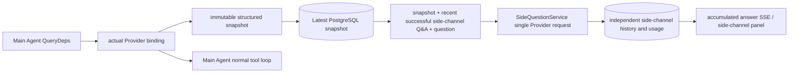

# ARTEX `/btw`

Normal chat, task MainAgent, and the current task's own Worker support independent side-channel questions. Type `/btw question` in the main input box to submit; an empty `/btw` or the "side-channel question" button opens history. Desktop uses a resizable sidebar, mobile uses a Drawer.

Side answers use the snapshot at submit time Agent Context-snapshot-based generation, supports streaming display, follow-up, stop and clear.closing the panel, refreshing the page or disconnecting SSE never cancels the model request.stopping affects only the current side channel; clearing cancels the side channel and deletes side-channel history, while keeping the main-context snapshot.

## Implementation Boundaries

keep using Go, norma v0.3.7, Next.js, existing Markdown / ResizablePanel / Drawer / AlertDialog component; No modifications norma Source code or added side-channel dependencies.Planner, inherited from other tasks Worker, tool-type subtask upgrades are out of scope.

- `capture.go` only marks main-loop requests at `Options.Deps.CallModel / CallModelSync`. The Provider decorator sits inside the concrete model, after outer routing-pool selection, so it records the actually selected model; compaction and summary requests do not overwrite the snapshot.
- Snapshots are published at request start, on complete model replies, and at run terminal state. Partial replies still being generated are not published; tool calls stay paired via norma's `MessagesForAPI`, and tool results enter the snapshot at the next main model request or run terminal state. Streaming aborts keep the last valid boundary.
- snapshots preserved via (JSON deep copy) JSON Deep copy preserves structured messages, system prompt, tool definitions and generation parameters.model inference holds no snapshot locks or DB transactions.
- `SideQuestionService` call the specific (provider) Provider; generate a side-channel summary first when needed, Final answer retries only on first context overflow with no output text yet/allow downsized tool calls — retry once. It creates no agent session, connects to no tool executor, main transcript, activity stream or task graph, and does not go through the task model-switching chain. The answer retains tool definitions for compatibility with the existing structured tool context; summary requests are given no tools. Newly returned tool calls have no execution path.
- One run request per parent session, At most four per service process, single-run timeout 120 seconds.side channel uses an independent cancellation context under the service lifecycle.
- Side requests retain model config references and non-sensitive identity summaries; fetch credentials from the existing config at request time.config deleted, or the model, protocol, changes to identity fields such as address, require running the main Agent first to update the snapshot. Tests will not change product default model.

## Persistence and Recovery

`db/schema.sql` auto-create `side_question_sessions` and `side_question_requests`.the former stores the parent resource, latest snapshot, run number, Version and cleanup version; the latter stores questions, cumulative answers, Status, model, snapshot time, usage, event sequence and pagination sequence numbers.

Parent session keys use the conversation ID, or task ID + exploration ID + intent ID. Workers do not use reusable execution-slot naming.

snapshots merged and written per parent session, every 250 ms refresh once, Database comparison `(run_id, version)` prevent stale versions from overwriting.re-save the selected snapshot before side-channel submit.free in-memory snapshots after saving; keep the pending version on failure.accumulated answer content caps at streaming events written once every 250 ms, terminal state is saved immediately with limited retries on database errors.

On service startup, leftover `running` requests are marked as `interrupted`, keeping persisted partial answers and usage without automatically replaying requests. The most recently saved context can be used directly for the next question. When an old session has no snapshot, the main Agent must run first; context is not rebuilt from UI activity records.

clearing bumps the cleanup version and deletes the request; conditional updates block late callbacks from writing back.physical parent deletion cascades via foreign keys, Worker soft delete removes side-channel data in same transaction, rejecting late snapshots afterwards.archiving blocks new requests first, wait for the main flow to stop, cancel and wait for side-channel persistence; archive format is v3, also compatible with v1/v2 lacking the side table v1/v2.

History is fully saved, returning at most 20 entries per page by sequence cursor. Model requests replay at most the latest 20 groups of successful Q&A originals, while also limiting replay volume by token budget; older Q&A maintains an independent rolling summary. When the main context exceeds budget, only the old part of the side-channel copy is summarized, keeping recent structured tool calls and results. Summaries, preparation progress, and usage are all subject to the side-channel concurrency, cancellation, and 120-second timeout limits. See [Context budget and open-source references](CONTEXT_BUDGET.md) for details.

## HTTP Contract

The following paths serve as `{parent}`, reusing existing authentication and resource validation:

- `/api/conversations/{id}`
- `/api/tasks/{id}/chat`
- `/api/tasks/{id}/intents/{iid}`

| request | returns and behavior |
| --- | --- |
| `GET {parent}/side-questions?before={ordinal}` | `items` sort newest-first, independent `current` run status, `snapshot` metadata, `next_cursor`; Cursor is 0 indicates latest page / no next page |
| `POST {parent}/side-questions` | JSON `{ "question": "...", "client_request_id": "UUID" }`; new requests return 202 And the request object; identical ID same ID and question return the existing object 200 |
| `DELETE {parent}/side-questions` | cancel and clear the parent session's side Q&A |
| `GET /api/side-questions/{requestID}/events` | `snapshot` SSE event, `id` Is a monotonically increasing sequence number, `data` Is the full cumulative request object; send on clear `cleared` |
| `POST /api/side-questions/{requestID}/cancel` | explicit cancellation; terminal state readable from history or (SSE) SSE read |

Questions are limited to 4000 characters. Missing snapshots, model configuration changes, a busy parent session, or idempotency ID conflicts return 409; the global concurrency limit returns 429. Each SSE connection first sends the accumulated state without relying on text fragments the client previously received. The frontend merges by request ID + sequence number, and discards old callbacks when switching parent sessions or clearing.

## Verification and References

See [VALIDATION.md](VALIDATION.md) for automated checks, real model usage, and known limitations.

Standalone-request reference [Grok CLI side-question.ts (pinned commit)](https://github.com/superagent-ai/grok-cli/blob/fb97af83f06dca873281d60168430f06c8de6324/src/utils/side-question.ts), run-isolation reference [OpenCode (pinned commit)](https://github.com/anomalyco/opencode/tree/b3f1a96c6dd7adeb28b36dd11add1998fc84d67b). ARTEX's context uses norma's structured messages, not the approach of stitching text together from frontend logs.
