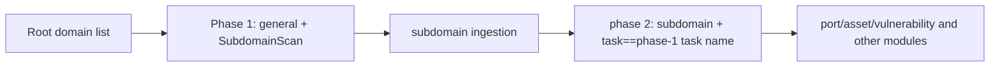

---

## name: scopesentry-mcp
description: Manage the security scanning platform (projects, tasks, templates, assets, nodes) via ScopeSentry MCP. Use when the user mentions ScopeSentry, MCP, API Key, scan tasks, or asset queries.

# ScopeSentry MCP User Guide

For users with a **deployed ScopeSentry instance**. Connect to the platform via Cursor (or another MCP client); no local source code needed.

## 1. Prerequisites

### 1.1 Verifying Service Accessibility

- Default web UI: `http://<host>`
- MCP endpoint: `http://<host>/mcp` (if a reverse proxy or frontend proxy sits in front, use the actual `/mcp` address)

### 1.2 Creating An API Key

1. Log in to the ScopeSentry web UI in a browser
2. Create a key on the **API Key** management page (or via an admin-provided interface)
3. Save the returned `ssk_...` string (**shown only once**)

### 1.3 Configuring Cursor MCP

Cursor -> Settings -> MCP -> add a server:

```json
{
  "mcpServers": {
    "scopesentry": {
      "url": "http://<host>:8082/mcp",
      "headers": {
        "X-API-Key": "ssk_your-key"
      }
    }
  }
}
```

Also works: `Authorization: Bearer ssk_your-key`

After configuration, restart MCP or reload Cursor, and confirm that tools such as `list_projects` and `list_assets` appear in the tool list.

---

## 2. Tool Overview


| tool                     | purpose                |
| ---------------------- | ----------------- |
| `list_projects`        | project tree grouped by tags (including projects ID) |
| `list_projects_data`   | Paginated project list, Searchable by name     |
| `get_project`          | project details              |
| `create_project`       | create project              |
| `list_tasks`           | scan task list            |
| `get_task`             | task details              |
| `list_scan_templates`  | scan template list            |
| `get_scan_template`    | template details              |
| `list_plugin_modules`  | scan pipeline module names          |
| `list_plugins`         | Available plugins (including hash, default params) |
| `create_scan_template` | create a scan template            |
| `create_scan_task`     | create a scan task            |
| `list_assets`          | Query assets of all types (Paginated list)       |
| `count_assets`         | count assets (`/api/assets/common/total`) |
| `get_asset_detail`     | asset or vulnerability details           |
| `add_asset_tag`        | Add tags to an asset           |
| `list_nodes`           | scan node list            |


Refer to each tool's MCP tool description (schema) for its parameters; `list_assets` / `count_assets` share the same search/filter syntax -- read the `list_assets` description before querying assets.

When you need the total count, use `count_assets` (it maps to the web pagination-total API); no need to page through `list_assets` repeatedly just to count.

---

## 3. Common Workflows

### 3.1 Querying Assets By Project

When the user or context **already specifies a project**, prefer passing `filter.project` to narrow the scope and avoid slow responses from excessive cross-project data. If no project is specified, the project filter is optional.

1. Use `list_projects` or `list_projects_data` to get the target project's **ObjectID** (`id` / `children[].value`)
2. Pass `filter.project` to `list_assets` (**must be the ID, not the project's Chinese name**)

```json
{
  "asset_type": "asset",
  "pageIndex": 1,
  "pageSize": 20,
  "search": "domain=^example.com",
  "filter": {
    "project": ["<project ObjectID>"]
  }
}
```

### 3.2 Creating A Scan Task

1. Use `list_nodes` to get online node names
2. Use `list_scan_templates` or `create_scan_template` to get the template **ObjectID**
3. `create_scan_task`: `name` and `node` are required; `template` takes the template ID (not the template name)

**Target source `targetSource` (same as the web UI):**

| targetSource | description | required parameters |
| --- | --- | --- |
| `general` | enter the target directly | `target` |
| `project` | Read targets from the project | `project` (project ObjectID array) |
| `asset` | from Web search the asset library | `search`; optional `project`, `filter`, `targetNumber` |
| `RootDomain` | Search from the root-domain library | `search`; optional `project`, `filter`, `targetNumber` |
| `subdomain` | Search from the subdomain library | `search`; optional `project`, `filter`, `targetNumber` |
| `UrlScan` | from URL search within scan results | `search`; optional `project`, `filter`, `targetNumber` |
| `*Source` (e.g. `subdomainSource`) | From the asset page"selected/search"Create | `targetTp=search` use when `search`; `targetTp=select` use when `targetIds` |

**Example -- scan root domains directly:**

```json
{
  "name": "example-subdomain-collection",
  "node": ["node-1"],
  "template": "<template ObjectID>",
  "targetSource": "general",
  "target": "example.com\nfoo.com",
  "project": ["<project ObjectID>"]
}
```

**Example -- continue scanning from the subdomain library (filter by the previous task name):**

```json
{
  "name": "example-ports-and-vulns",
  "node": ["node-1"],
  "template": "<follow-up-module template ObjectID>",
  "targetSource": "subdomain",
  "search": "task==\"example-subdomain-collection\"",
  "project": ["<project ObjectID>"]
}
```

### 3.3 Full Root Domain Information Gathering (Recommended Two-Phase Approach)

When the input consists of **root domains** and **full information gathering** is required, run two separate scans instead of the whole pipeline at once.

**Rationale:** distributed tasks are dispatched per **single target**. When a root domain is the target, the subdomains discovered on the node assigned that root domain keep running subsequent modules on the same node, which easily causes uneven load, slowness, and errors.

**Best practices:**

1. **Phase 1 -- subdomain collection only**
   - `targetSource`: `general`
   - `target`: all root domains (multiple lines)
   - Template: enable only `SubdomainScan` and `SubdomainSecurity` (subdomain scanning + subdomain takeover)
   - Wait for the task to finish with `get_task`

2. **Phase 2 -- subsequent modules**
   - `targetSource`: `subdomain`
   - `search`: `task=="<phase-1 task name>"` (exact task-name match)
   - Optional `project` to narrow the scope
   - Template: port scanning, asset mapping, vulnerability scanning, etc. (may exclude SubdomainScan)
   - Subdomains are dispatched to nodes as independent targets for higher parallelism

Alternatively, filter by task name on the web UI's “Subdomains” asset page and use “create task from subdomains” for the same effect.



### 3.4 Creating A Scan Template

1. `list_plugin_modules` -> list of module names
2. `list_plugins` (filterable by `module`) -> each plugin's `hash` and default `parameter`
3. `create_scan_template`: use `modules` to specify "module -> plugin hash array"

---

## 4. Asset Queries (`list_assets` / `count_assets`)

`count_assets` uses the same `asset_type`, `search`, and `filter` as `list_assets`, returning `{ "total": N }`, corresponding to the web endpoint `/api/assets/common/total`.

```json
{
  "asset_type": "subdomain",
  "search": "task==\"<task name>\"",
  "filter": {"project": ["<project ObjectID>"]}
}
```

**Performance tips (shared by `list_assets` / `count_assets`):** when a project condition is available, prefer `filter.project` to narrow the scope; in `search`, for indexed fields use `==` exact match or `^` prefix match where possible (see [4.3](#43-search-query-expressions)), and avoid broad `=` fuzzy queries that slow down responses. Without project context, adding a project filter is not required.

See the table in [4.4](#44-precise-filtering-with-filter) (exact filtering) for the types supporting `filter.project`.

### 4.1 Asset Type `asset_type`

`asset`、`RootDomain`、`subdomain`、`app`、`mp`、`UrlScan`、`SensitiveResult`、`DirScanResult`、`crawler`、`vulnerability`、`PageMonitoring`、`IPAsset`、`SubdomainTakerResult`

Alias examples: `web`->asset, `vuln`->vulnerability, `ip`->IPAsset, `url`->UrlScan

### 4.2 Parameter Descriptions


| parameter                       | description                                      |
| ------------------------ | --------------------------------------- |
| `pageIndex` / `pageSize` | pagination, Default 1 / 20                            |
| `search`                 | search expression (see the next section)                              |
| `filter`                 | exact filtering JSON (see the next section)                          |
| `sort`                   | only UrlScan, DirScanResult supports sorting by `length` sorting |
| `sid`                    | only SensitiveResult: Sensitive rule name                |


`search` and `filter` **can be used together**.

### 4.3 search Query Expressions

Custom DSL (**not SQL**):


| operator  | meaning   | index | example                          |
| ---- | ---- | ---- | --------------------------- |
| `=`  | fuzzy match (regex) | no index used | `domain=example`            |
| `==` | exact match (exact equality) | **use index** | `port==443`                 |
| `!=` | exclude   | -- | `port!="80"`                |
| `&&` | and    | -- | `domain==example.com && port==443` |
| `||` | or    | -- | `title=admin || body=login` |


**Indexes and operators:** fields such as `domain`, `ip`, `port`, and `title` are indexed, but only **`==` exact match** or **prefix match with values starting in `^`** (e.g. `domain=^example.com`) can use the index; **`=` becomes a regex fuzzy match and cannot use the index**, and is prone to slowness on large data volumes.

**search fields common to all types:** `tag`, `task` (task name), `rootDomain`

**project must not be written in search** (invalid or errors when combined with `&&`). To filter by project, use `filter.project`.

**Commonly used search fields per type:**


| asset_type           | field                                                                                  |
| -------------------- | ----------------------------------------------------------------------------------- |
| asset                | domain, ip, port, service, app, title, statuscode, icon, banner, type, body, header |
| RootDomain           | domain, icp, company                                                                |
| subdomain            | domain, ip, type, value                                                             |
| app                  | name, icp, company, category, description, url, apk                                 |
| mp                   | name, icp, company, category, description, url                                      |
| UrlScan              | url, input, source, resultId, type                                                  |
| SensitiveResult      | url, sname, body, info, md5                                                         |
| DirScanResult        | url, statuscode, redirect, length                                                   |
| vulnerability        | url, vulname, matched, request, response, level                                     |
| crawler              | url, method, body, resultId                                                         |
| PageMonitoring       | url, hash, diff, response                                                           |
| IPAsset              | ip, domain, port, service, webServer, app                                           |
| SubdomainTakerResult | domain, value, type, response                                                       |


**search examples:**

- `domain==www.example.com && port==443` (exact match, uses index)
- `domain=^example.com` (prefix match, uses index)
- `ip==192.168.1.1`
- `task=="<task name>"`
- `level==high`（vulnerability）
- `statuscode==200`（DirScanResult）

Use `=` only when fuzzy containment is needed, e.g. `title=admin` (not indexed; preferably combined with project or similar conditions to narrow the scope).

### 4.4 Precise Filtering With filter

JSON object: multiple values under the same key mean **OR**, different keys mean **AND**.

**Prefer `project` when a project condition exists:** if the user or context has identified a project and the asset_type supports `project`, include it to narrow the scope; not required when no project information is available.


| filter key   | meaning       | Value descriptions                                                     |
| ------------ | -------- | -------------------------------------------------------- |
| `project`    | owning project     | **ObjectID**, use `list_projects` / `list_projects_data` fetch |
| `task`       | source task     | **task name**, use `list_tasks` 's `name`                         |
| `port`       | Port       | e.g. `"443"`                                                |
| `service`    | Service/protocol    | e.g. `"https"`                                              |
| `app`        | application fingerprint     | e.g. `"Nginx"`                                              |
| `icon`       | icon hash  |                                                          |
| `statuscode` | HTTP status code | Primarily used for ... asset                                               |
| `status`     | Status       | UrlScan/DirScan HTTP status code; Vulnerability/sensitive-data handling status                       |
| `level`      | severity     | critical / high / medium / low / info                    |
| `type`       | type       | e.g. subdomain record types A, CNAME                                         |
| `color`      | Sensitive rule color   | SensitiveResult                                          |
| `sname`      | sensitive-rule name    | SensitiveResult                                          |
| `tags`       | label       |                                                          |


**Available filter keys per type:**


| asset_type                            | filter key                                                      |
| ------------------------------------- | --------------------------------------------------------------- |
| asset                                 | project, port, service, app, icon, statuscode, type, task, tags |
| RootDomain                            | project, tags                                                   |
| subdomain                             | project, type, task, tags                                       |
| app / mp                              | project, tags                                                   |
| UrlScan                               | status, tags                                                    |
| DirScanResult                         | status, tags                                                    |
| SensitiveResult                       | status, color, sname, tags                                      |
| crawler                               | project, task, tags                                             |
| vulnerability                         | project, level, status, task, tags                              |
| PageMonitoring / SubdomainTakerResult | tags                                                            |
| IPAsset                               | project, port, service, app                                     |


**filter examples:**

```json
{"project": ["<project ObjectID>"], "port": ["443"]}
```

**Combined query example:**

```json
{
  "asset_type": "asset",
  "search": "domain=^baidu && port==443",
  "filter": {"project": ["<project ObjectID>"]},
  "pageIndex": 1,
  "pageSize": 10
}
```

**Notes:**

- Prefer including `filter.project` when a project condition exists (where supported); not required without project context
- Do not put the project display name in `filter.project`
- Use `==` for known values and `^` for prefixes; avoid abusing `=` fuzzy matching on large tables
- For UrlScan HTTP status use `filter.status`; for DirScanResult you can use `statuscode==200` in search
- SensitiveResult by rule name: use `sname=<rule name>` in `search`, or `filter.sname`

### 4.5 Sorting With sort

Supported only for **UrlScan** and **DirScanResult**:

```json
{"length": "ascending"}
```

Other types ignore `sort` and are sorted by time by default.

---

## 5. Scan Template Module Names

`TargetHandler`、`SubdomainScan`、`SubdomainSecurity`、`PortScanPreparation`、`PortScan`、`PortFingerprint`、`AssetMapping`、`AssetHandle`、`URLScan`、`WebCrawler`、`URLSecurity`、`DirScan`、`VulnerabilityScan`、`PassiveScan`

---

## 6. Troubleshooting


| symptom        | handling                                                 |
| --------- | -------------------------------------------------- |
| MCP no tools   | check URL, API Key, ScopeSentry Whether it is running                    |
| 401 / 403 | recreate or replace API Key                                    |
| asset not found     | confirm `filter.project` is ObjectID; don't ... in search write in project |
| template/task creation failed | `template` must be a template ObjectID; `node` fill in an online node name            |
| Query is very slow/stuck   | Add when a project exists `filter.project`; search for indexed fields, switch to `==` or `^` prefix, use sparingly `=`; narrow down `pageSize` |


---

